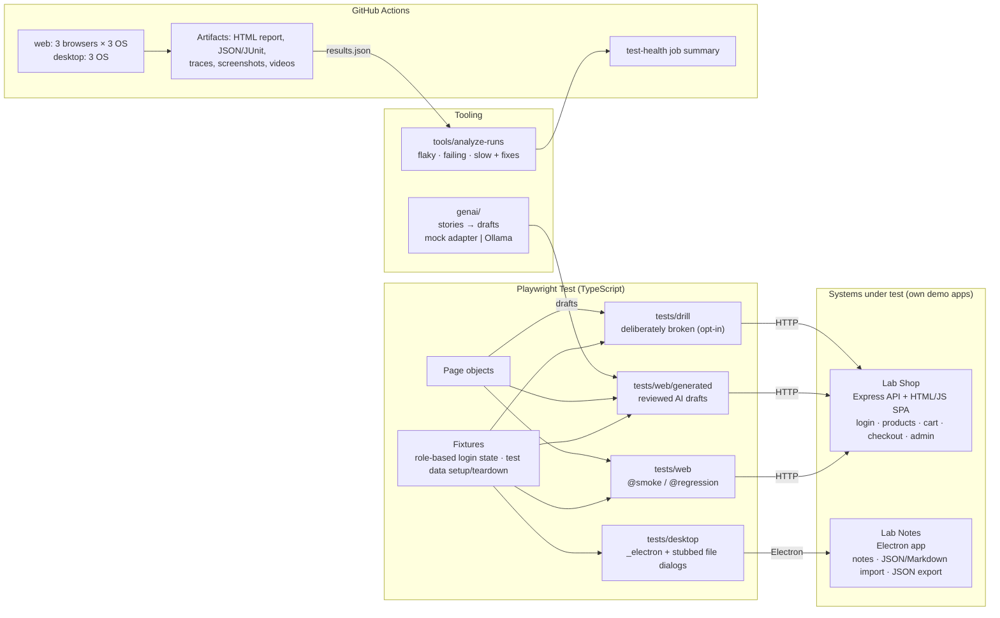

# playwright-e2e-lab

[](https://github.com/hamza2829/playwright-e2e-lab/actions/workflows/ci.yml)

An end-to-end test automation lab built with **Playwright Test and TypeScript**. It tests a web shop in Chromium, Firefox and WebKit, and an Electron desktop app on Ubuntu, Windows and macOS. It also includes a GenAI helper that drafts tests from user stories, and a tool that finds flaky and slow tests in past run reports. Everything runs in GitHub Actions: no Docker, no API keys, no accounts, no manual steps.

> **Both systems under test are my own demo applications**, written for this project: **Lab Shop** (`apps/web`) and **Lab Notes** (`apps/desktop`). They are not real products and hold no real data.

## Architecture



## Repository layout

| Path | What it is |
| --- | --- |
| `apps/web` | Lab Shop: Express API (in-memory store, `/api/test/*` helpers for data setup) and a single-page frontend |
| `apps/desktop` | Lab Notes: Electron main, preload and renderer in TypeScript, with import/export logic in `notes-format.ts` |
| `tests/web` | Web suite: `fixtures.ts`, `pages/` (page objects), `support/shop-api.ts` (API client), specs |
| `tests/desktop` | Electron suite: launch fixture (isolated profile, video, trace), `NotesWindow` page object, specs and data files |
| `tests/drill` | The failure-drill test, run only with `DRILL=1` |
| `genai/` | User stories, draft generator, adapters, review checklist and evaluation |
| `tools/analyze-runs` | Flaky and slow test analyzer for Playwright JSON reports |
| `docs/failure-drill-rca.md` | Root cause analysis of the drill failure |
| `.github/workflows` | `ci.yml`, `failure-drill.yml`, `genai-local-model.yml` |

## What is covered

- **Critical web flows:** login (valid, invalid, redirect back, logout), product list and search, out-of-stock handling, cart quantity, shipping and totals, end-to-end checkout with field validation and stock decrement, admin product management, access control, and API contract checks.
- **Critical desktop flows:** create, edit, delete and search notes, persistence across restarts, import from JSON and Markdown (invalid file, duplicates, cancel), export to JSON, and a round trip into a fresh profile.
- **Tags:** `@smoke` is a fast gate (run first in CI). `@regression` is the full suite. Use `npm run test:smoke` or `npm run test:regression`.
- **Login state:** `test.use({ role: 'customer' | 'admin' })`. The fixture creates a unique user through the test API, injects its session before the app loads, and deletes the user (with cart and orders) in teardown.
- **Test data:** arranged through the API (`ShopApi`, `createProduct` fixture). Names are unique per test, so the suite runs fully parallel with no ordering dependencies.

## CI pipeline

| Workflow | Trigger | Jobs |
| --- | --- | --- |
| **CI** (`ci.yml`) | push to `main`, pull requests, manual | typecheck + unit tests + GenAI reproducibility → `@smoke` on Chromium → **web matrix** (chromium/firefox/webkit × ubuntu/windows/macos) · **desktop matrix** (ubuntu/windows/macos) · GenAI mock evaluation → **test health** analysis |
| **Failure drill** (`failure-drill.yml`) | manual only | runs the deliberately broken test against a slowed API. The `broken` variant is expected to be **red** |
| **GenAI (local model)** (`genai-local-model.yml`) | manual only | installs Ollama, pulls a small open model, drafts and evaluates tests |

CI uses 2 retries and 2 workers. A test that only passes on a retry is reported as **flaky**, both in the HTML report and in the test-health summary, so it is not hidden.

## How to read the reports

1. Open a workflow run on the **Actions** tab. The **Summary** page shows annotations for failures, the **GenAI draft evaluation** table and the **Test health report** (flaky, consistently failing and slowest tests, with suggested fixes).
2. Under **Artifacts**:
   - `playwright-report-web-<browser>-<os>` / `playwright-report-desktop-<os>`: the HTML report. Unzip it and run `npx playwright show-report <folder>`, or open `index.html`. Use the *Flaky* and *Failed* filters. A failed test has its **trace** (step-by-step DOM snapshots, network and console), **screenshot** and, for web tests, **video**.
   - `json-report-*`: Playwright JSON and JUnit output. The test-health job reads these, plus the same artifacts from the last 5 runs on `main`.
   - `test-results-*` (only on failure): the raw trace, screenshot and video files.
   - `test-health-report`: `report.md` and `report.json` from the analyzer.
   - `genai-evaluation-*`: the drafts, the prompts and the evaluation.
3. To open a trace directly: `npx playwright show-trace path/to/trace.zip`, or drop it on [trace.playwright.dev](https://trace.playwright.dev).

The worked example is the failure drill: [docs/failure-drill-rca.md](docs/failure-drill-rca.md).

## GenAI helper

```bash
npm run genai:draft                       # mock adapter -> genai/drafts/mock
npm run genai:draft -- --adapter ollama   # needs a local Ollama server
npm run genai:evaluate                    # compare drafts with tests/web/generated
```

The **mock adapter** is a deterministic rule-based "model". CI uses it by default because it needs no secrets and gives reproducible numbers (CI fails if the committed drafts are out of date). The **Ollama adapter** runs a small open model that the optional workflow downloads at run time. Drafts are never trusted directly: they go through [the review checklist](genai/REVIEW_CHECKLIST.md). The measured results, including how many drafts needed changes, are in [genai/EVALUATION.md](genai/EVALUATION.md).

## Maintenance tooling

```bash
npm run analyze -- reports/ path/to/older/reports --slow-ms 5000 --top 8
```

`tools/analyze-runs` reads any number of Playwright JSON reports, groups results by test and project, and reports:

- **flaky** tests: tests that passed only on retry, or passed in some runs and failed in others, with their flake rate
- **consistently failing** tests
- **slow** tests: tests whose p95 is over a threshold, plus the top N

For each one it suggests a fix. Suggestions come from error-message rules (strict mode violation, timeouts, closed targets, connection refused) and from reading the test's source (non-retrying assertions, `waitForTimeout`, `networkidle`, `force: true`, UI login in slow tests). Sample reports from real runs are in `tools/analyze-runs/fixtures/`.

## Run locally (optional)

Everything is designed for CI, but it also runs locally with Node 20 or newer:

```bash
npm ci
npx playwright install
npm run typecheck && npm run test:unit
npx playwright test --project=chromium   # starts the web app automatically
npm run test:desktop                     # builds and tests the Electron app
npm run test:drill                       # the failure drill (expected to fail)
```

Demo accounts: `alice / alice123` (customer), `admin / admin123` (admin).

## Design decisions

- **Playwright for both web and desktop.** One runner, one report format and one set of failure evidence. Electron is driven through `_electron`.
- **The app exposes test hooks (`/api/test/*`), and the tests arrange data through the API.** UI tests then exercise only the UI they verify. This keeps them fast and independent, and makes parallel runs across browsers safe. The hooks can be turned off with `ENABLE_TEST_API=0`.
- **Login state as a fixture option (`role`)** instead of a shared `storageState` file. Each test gets its own user, so no test can leak a cart or an order into another.
- **Native file dialogs are stubbed** in the Electron main process (`dialog.showOpenDialog`), because the operating system's dialogs cannot be automated across platforms. The import/export logic underneath is real.
- **Failure evidence only on failure** (`retain-on-failure` / `only-on-failure`), which keeps green runs small. For Electron, the runner adds failure screenshots and the fixture records a DOM-snapshot trace. Video is opt-in (`ELECTRON_VIDEO=1`): on CI virtual machines the Electron window never delivered a screencast frame, so recording stalled the first page load on every OS. The test-health history from the first CI runs still shows this.
- **Locators:** roles and labels first, `data-testid` where there is no good accessible handle. Web-first assertions everywhere. The drill shows why.
- **No merged cross-OS report.** Each matrix job publishes its own HTML report, and the analyzer combines the JSON reports. This avoids path problems when merging blob reports from different operating systems.
- **Node 20 and Electron 39.** The spec requires Node 20. Electron 40 and later need Node 22.12 or newer to install, so the desktop app is pinned to Electron 39. Moving CI to Node 22 would allow the current Electron release.
- **TypeScript is compiled only where it must be** (the Electron app). Tests, tools and the web server run through Playwright's TypeScript support and `tsx`.

## License

MIT. See [LICENSE](LICENSE).
